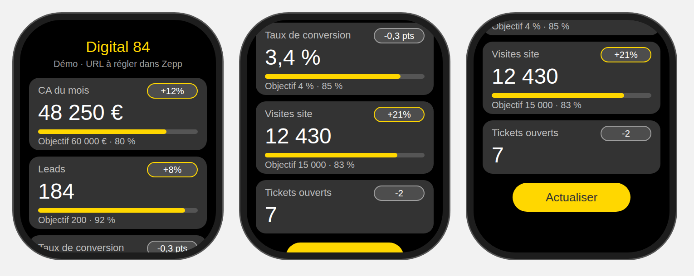

# KPI Digital 84 — Amazfit Bip Max

Application **Zepp OS** pour afficher votre dashboard KPI sur la montre **Amazfit Bip Max**
(écran 432 × 514, Zepp OS 5, `deviceSource` 11206915).



## Fonctionnement

```
Votre source KPI (API, Google Sheets…)  ──HTTPS──▶  App Zepp (téléphone)  ──Bluetooth──▶  Montre
                                                    app-side/index.js            page/index.js
```

- La **montre** affiche une carte par KPI : libellé, valeur, tendance, barre de progression vers l'objectif.
- Le **téléphone** (service `app-side`) télécharge le JSON, le met en forme (séparateurs de milliers, %, €) et l'envoie à la montre.
- Les dernières données sont **mises en cache** sur la montre : elles restent visibles hors connexion.
- Bouton **Actualiser** en bas de l'écran ; mise à jour automatique à l'ouverture.
- Sans URL configurée, l'app affiche des **données de démo**.

## Format JSON attendu

```json
{
  "title": "Digital 84",
  "updatedAt": "03/10 · 09:30",
  "kpis": [
    { "label": "CA du mois", "value": 48250, "unit": "€", "target": 60000, "trend": 12 },
    { "label": "Tickets ouverts", "value": 7, "trend": -2, "trendUnit": "" }
  ]
}
```

| Champ | Obligatoire | Description |
| --- | --- | --- |
| `label` | oui | Nom du KPI (28 caractères max) |
| `value` | oui | Nombre (mis en forme automatiquement) ou texte |
| `unit` | non | `€`, `%`, `h`… |
| `target` | non | Objectif : affiche la barre de progression |
| `progress` | non | Forcer la progression (`0.8` ou `80`) |
| `trend` | non | Évolution ; positive = contour jaune, négative = contour gris |
| `trendUnit` | non | Unité de la tendance (défaut `%`, ex. `" pts"` ou `""`) |

8 KPI maximum. Un tableau seul (`[ {...}, {...} ]`) est aussi accepté.
Exemple complet : [`examples/kpi.json`](examples/kpi.json).

### Brancher Google Sheets en 5 minutes

Le script [`examples/google-sheets-apps-script.gs`](examples/google-sheets-apps-script.gs)
transforme un onglet `KPI` (colonnes `label | value | unit | target | trend`) en URL JSON.
Les instructions de déploiement sont en tête du fichier.

N'importe quelle autre source convient (Looker Studio via API, n8n/Make, back-office maison…)
du moment qu'elle renvoie ce JSON en HTTPS.

## Réglages (app Zepp sur le téléphone)

App Zepp → **Profil** → **Amazfit Bip Max** → **Applications** → **KPI Digital 84** → réglages :

- **URL des KPI** : l'adresse du JSON.
- **Jeton d'API** (optionnel) : envoyé en `Authorization: Bearer <jeton>`.

## Installer sur la montre

Prérequis : Node.js 18+, un compte Zepp, la montre appairée à l'app Zepp.

```bash
npm i -g @zeppos/zeus-cli
cd kpi-dashboard-bip-max
npm install
zeus login          # compte Zepp
zeus preview        # choisir « Amazfit Bip Max » → un QR code s'affiche
```

Dans l'app Zepp : **Profil → Paramètres → À propos**, touchez 7 fois l'icône Zepp pour activer le
**mode développeur**, puis **Profil → Mode développeur → Scanner** et scannez le QR code.
L'app s'installe sur la montre (menu des applications → « KPI Digital 84 »).

Pour un paquet de production : `zeus build` (fichier `.zab` dans `dist/`), à publier si besoin
sur la [Zepp Open Platform](https://console.zepp.com/).

## Structure

```
app.json              Configuration (cible : écrans carrés 432 px, API Zepp OS 3.0+)
app.js                Point d'entrée
page/index.js         Écran montre (cartes KPI, cache, bouton Actualiser)
app-side/index.js     Service téléphone : téléchargement + envoi à la montre
setting/index.js      Écran de réglages dans l'app Zepp
utils/kpi.js          Normalisation / mise en forme des KPI + données démo
utils/theme.js        Couleurs de la charte Digital 84
assets/common.s/      Icône
examples/             JSON d'exemple + script Google Sheets
```
